

<b>TU MAGNA 2 230, EN EL AIRE.</b>

# MagnAir

Firmware nuevo para el módulo WiFi que trae la Hellbot Magna 2 (MKS Robin WiFi, un ESP8266), con su página web y apps para Android, Windows y Linux. Lo hice y lo pruebo en una 230, pero el módulo es el mismo en la 300, 400 y 500, con placa V1.2 o V1.3. Con eso manejás la impresora desde el celular o la compu: ves cómo va la impresión, subís archivos, mirás la cámara y te llegan avisos por Telegram aunque no estés en casa.

Lo armé para mi Magna 2 230 con placa MKS Robin Nano V1.3. Va de la mano con mi firmware para la impresora (mm2, Marlin 2.1.3): algunas cosas, como la hora en la pantalla, necesitan los dos.

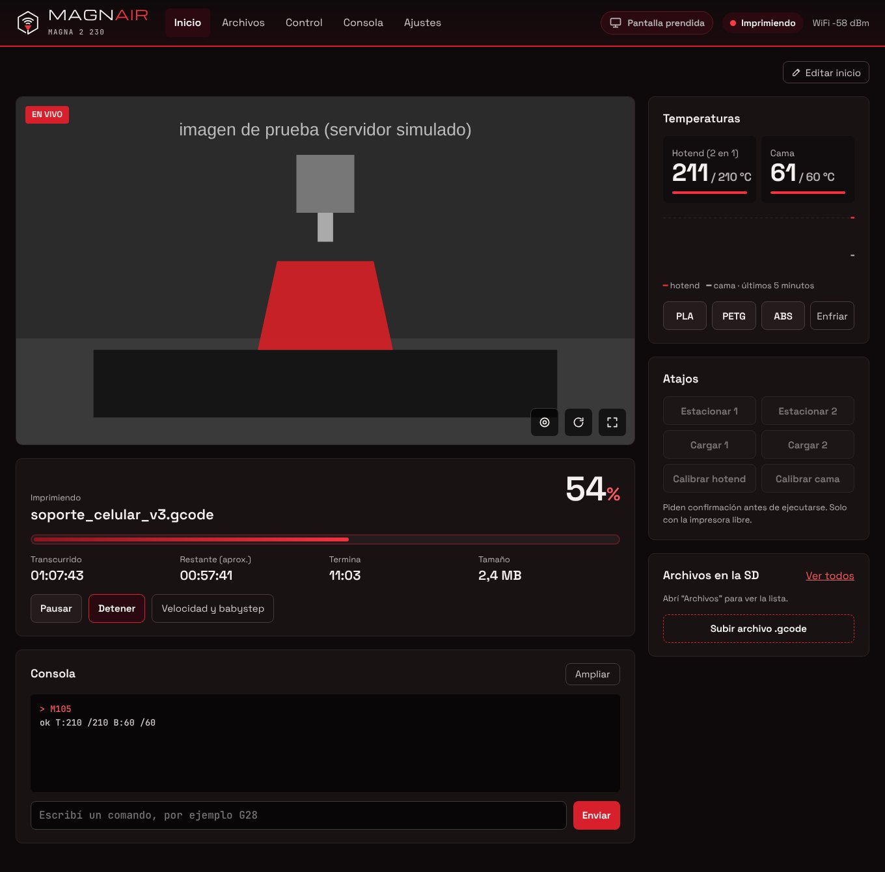

## Contenido

- [Inicio](#inicio)
- [Archivos, historial y visor 3D](#archivos-historial-y-visor-3d)
- [Control](#control)
- [Consola](#consola)
- [Telegram](#telegram)
- [Cola e imprimir a una hora](#cola-e-imprimir-a-una-hora)
- [Pantalla de la impresora](#pantalla-de-la-impresora)
- [Cámara y timelapse](#cámara-y-timelapse)
- [Apps de Android, Windows y Linux](#apps-de-android-windows-y-linux)
- [Varias impresoras y modelos](#varias-impresoras-y-modelos)
- [Instalar](#instalar)
- [Descargas](#descargas)
- [Cosas que no se pueden](#cosas-que-no-se-pueden)

## Inicio

La pantalla de inicio tiene la cámara, el avance de la impresión (tiempo que pasó, el que falta y a qué hora termina), las temperaturas con un gráfico de los últimos minutos, botones para precalentar PLA, PETG o ABS y la consola.

Las tarjetas se mueven arrastrándolas, se esconden con la cruz y se vuelven a poner con "+". El orden se guarda en el módulo, así que se ve igual en la página y en las apps.

| Celular | |
|---|---|
| 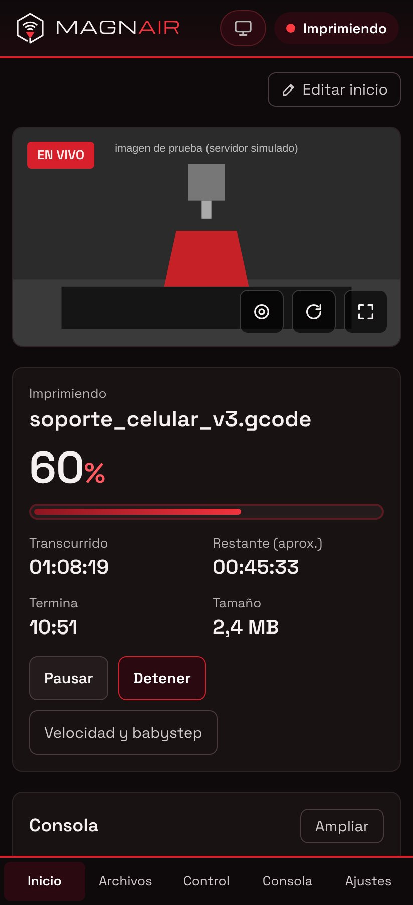 | 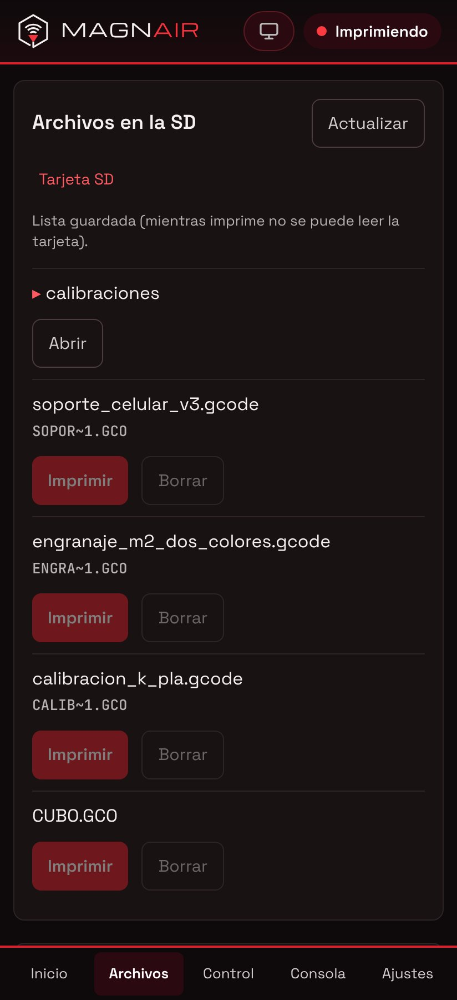 |

## Archivos, historial y visor 3D

La lista de la SD con carpetas. Desde ahí imprimís, borrás o subís un `.gcode` arrastrándolo, y si querés que empiece a imprimir apenas termina de subir.

Abajo queda el historial de cada impresión (cuánto tardó, cuánto filamento usó, cuánto costó y si terminó bien) y los totales de la impresora. El costo sale del precio del rollo que pongas en Ajustes.

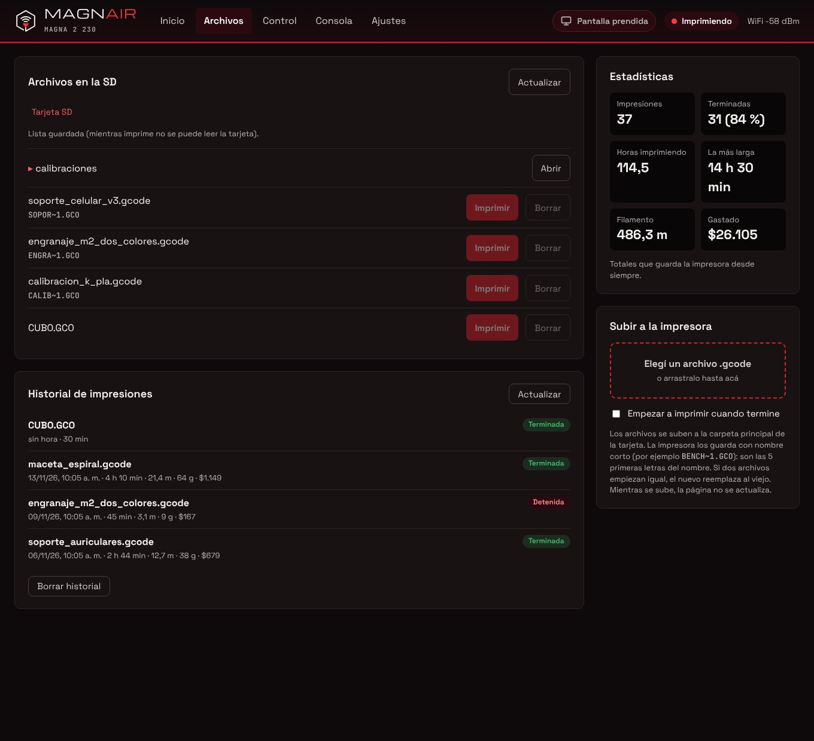

En las apps hay además un **visor 3D**: abrís un gcode y ves la pieza capa por capa, con colores para paredes, relleno y soportes. En cualquier capa podés agregar una pausa, un cambio de filamento, otra temperatura, ventilador, velocidad o un mensaje para la pantalla, y mandarle esa copia a la impresora. El archivo original no se toca.

## Control

Mover los ejes, ir al inicio, extruir o retraer con cada extrusor, temperaturas a mano, ventilador, velocidad, flujo y babystep. También están los valores de la última calibración (MPC, PID de la cama, pasos, avance de presión, compensación de vibraciones…) y las funciones de Marlin que la pantalla no tiene en ningún menú.

Desde acá se prenden o apagan la recuperación tras un corte de luz y el sensor de filamento, se puede dormir la impresora (apaga calentadores, ventilador y motores y oscurece la pantalla; la fuente sigue prendida porque la placa no puede cortarse la luz), y está la nivelación a mano: la boquilla va a cada esquina y al centro para ajustar las perillas con un papel.

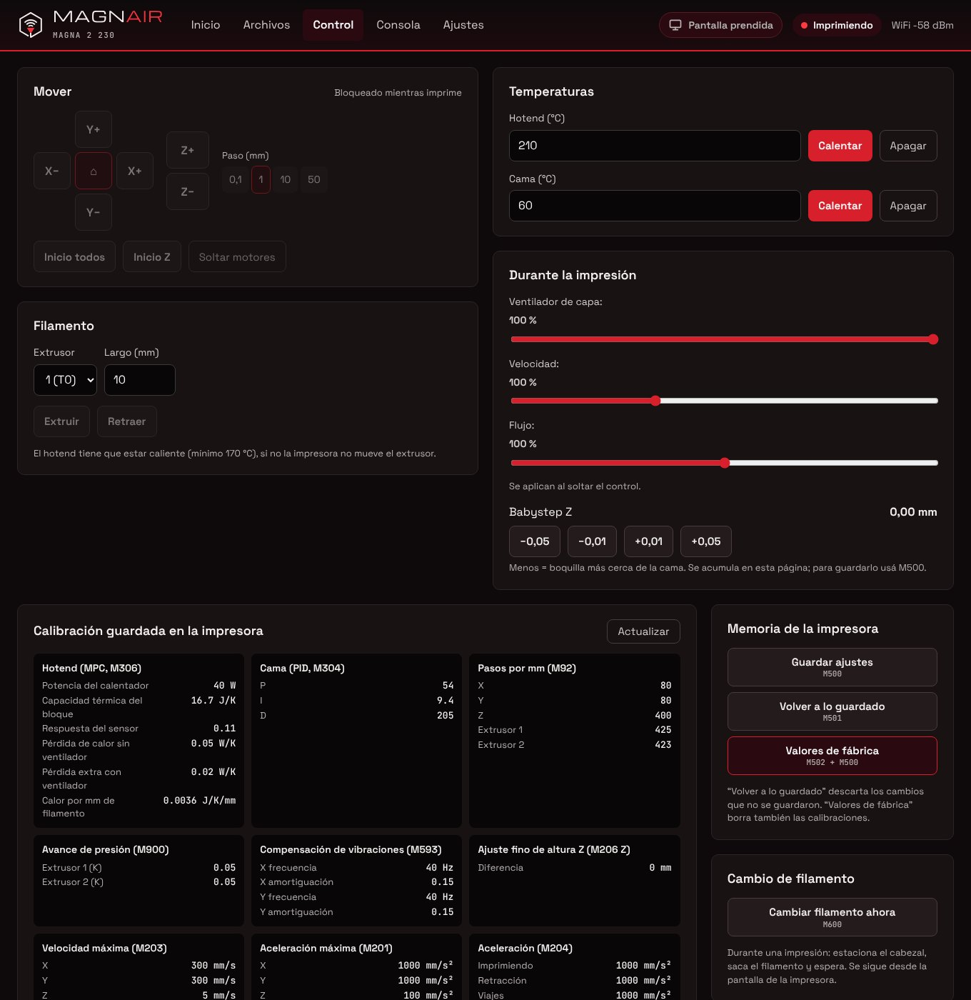

## Consola

Para mandar G-code a mano y ver lo que contesta la impresora. Abajo hay botones con las funciones más usadas, cada una con su código para ir aprendiéndolos.

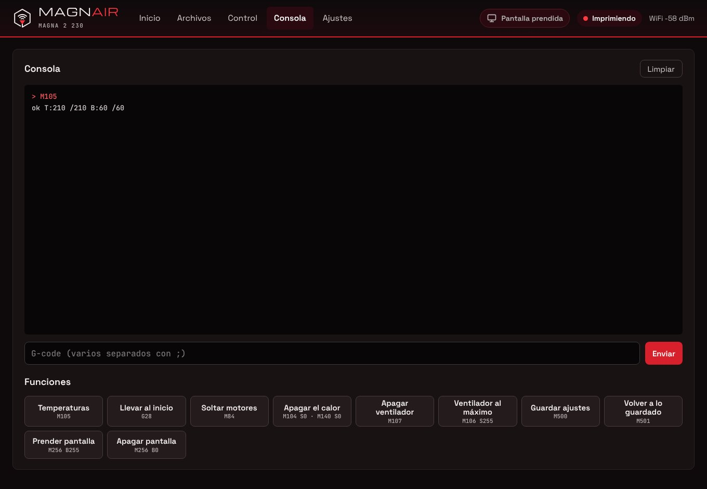

## Telegram

Con un bot propio de Telegram el módulo te avisa cuando termina una impresión (con duración, filamento y costo), si se detuvo, si quedó en pausa por falta de filamento, si terminó una calibración o si la impresora se detuvo por un error (falla de temperatura, termistor…). Puede mandar fotos de la cámara al 25, 50 y 75 %.

También le podés mandar comandos desde cualquier lado, sin VPN ni abrir puertos: `/estado`, `/foto`, `/pausar`, `/seguir`, `/detener`, `/enfriar`, `/dormir` (todo apagado y la pantalla oscura), `/precalentar PLA`, `/temp 210 60`, `/archivos`, `/imprimir`, `/historial`, `/estadisticas`, `/mensaje` (aparece en la pantalla de la impresora), `/cola`, `/siguiente` y `/menu`, que muestra todo con botones. Si le mandás un `.gcode` al bot, lo pasa a la SD y te ofrece imprimirlo.

| Configuración | El bot |
|---|---|
| 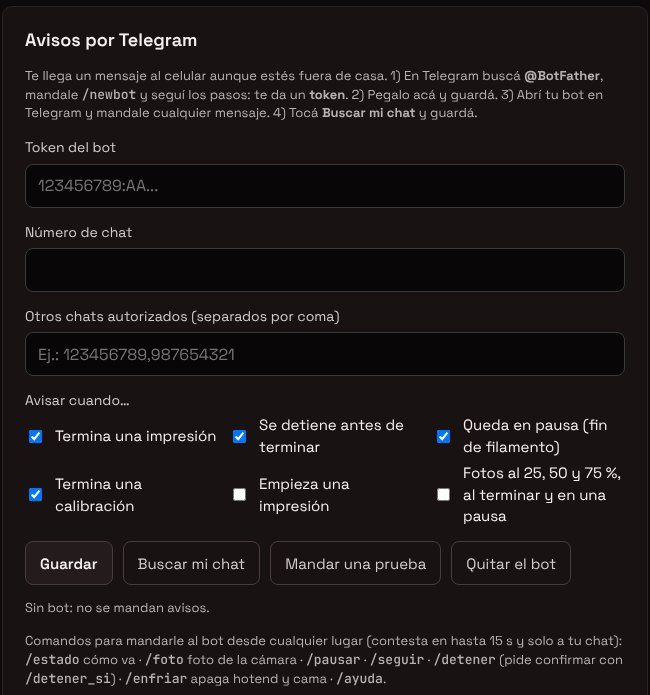 |  |

## Cola e imprimir a una hora

Se pueden dejar varios archivos de la SD en fila. Cuando termina uno, Telegram avisa cuál sigue, y lo arrancás cuando sacaste la pieza (desde la app, la página o `/siguiente`). También se puede elegir un archivo y una hora para que el módulo lo empiece solo, por ejemplo para que termine cuando volvés.

Los pasos para crear el bot están en la sección Telegram de las apps (o en Ajustes de la página). Solo contesta a tu chat y a los que agregues.

## Pantalla de la impresora

Con el firmware mm2 en la impresora, el módulo le pasa a la pantalla de la impresora la hora (la saca de internet), si Telegram está andando y algunas opciones: animaciones, melodías y que la pantalla quede siempre encendida mientras imprime. Desde acá también le podés mandar un mensaje que aparece en la pantalla, y hay un botón arriba para prenderla o apagarla.

  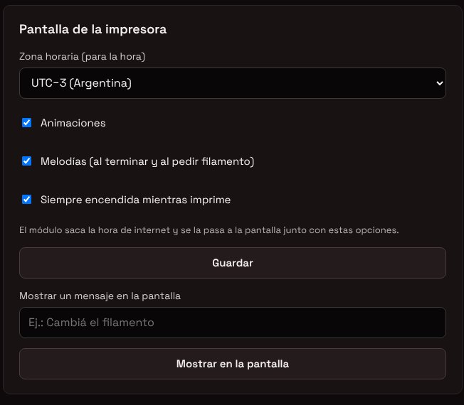
  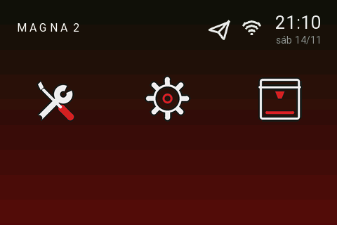

## Cámara y timelapse

Como cámara sirve un celular Android viejo con la app IP Webcam: ponés la IP del celular y listo (las apps la buscan solas en la red). Se puede girar, espejar y ver en pantalla completa. Más detalles en [docs/CAMARA.md](docs/CAMARA.md).

Las apps pueden hacer un timelapse: sacan una foto cada 10, 30 o 60 segundos y al terminar dejan el video en Películas/MagnAir (Android) o Videos\MagnAir (Windows).

## Apps de Android, Windows y Linux

Las dos apps son el mismo código (Kotlin con Compose Multiplatform) y tienen lo mismo que la página, más el visor 3D, el timelapse y avisos del sistema aunque la app esté cerrada. Buscan solas el módulo en la red, recuerdan el último y, si no está, se puede entrar igual con "Continuar sin conexión".

Se ven como la pantalla de la impresora: mismos íconos, el mismo fondo, la hora arriba y temperaturas que cambian de color mientras calientan. Están en cuatro partes: **Inicio**, **Imprimir** (SD, cola, subir y visor), **Máquina** (mover, temperaturas, filamento, nivelar y lo avanzado) y **Más** (historial, Telegram, cámara, ajustes).

Además llevan la cuenta de los rollos de filamento, aprenden cuánto tarda tu máquina comparado con lo que dice el slicer, guardan una foto de cada impresión, exportan el historial a una planilla y hacen una copia de la calibración para volver a cargarla después de flashear. En Android hay widget (que sigue la impresión aunque cierres la app), notificación con el avance, accesos directos y se puede compartir un `.gcode` a la app para subirlo.

| Windows | Celular |
|---|---|
| 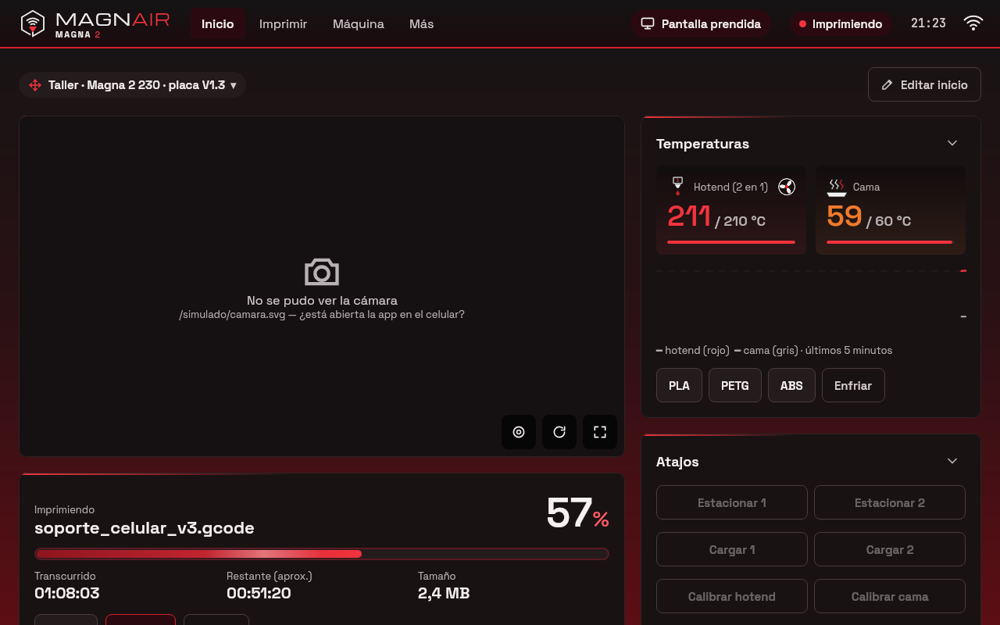 | 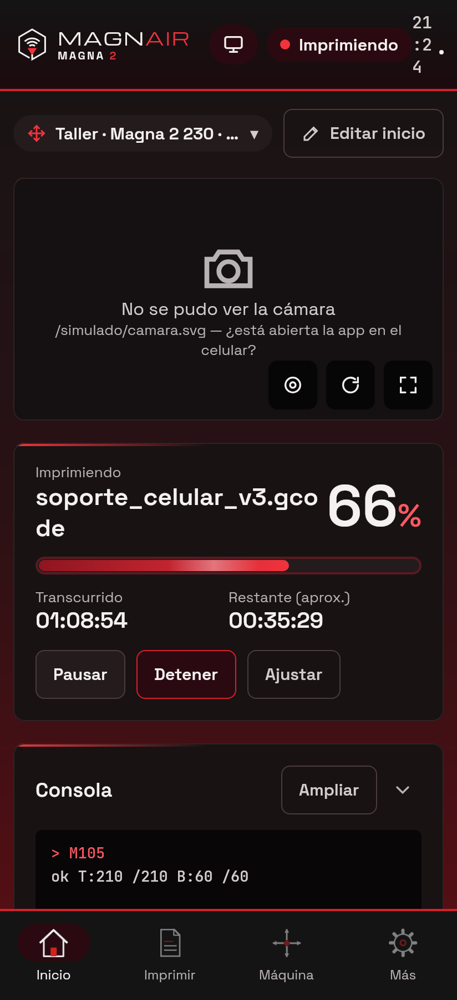 |
| 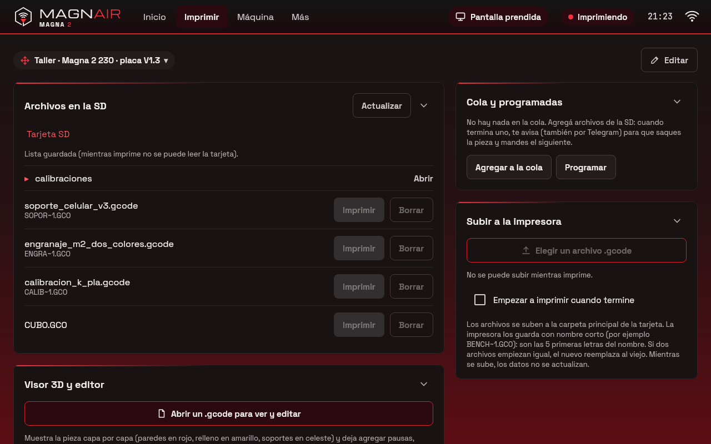 | 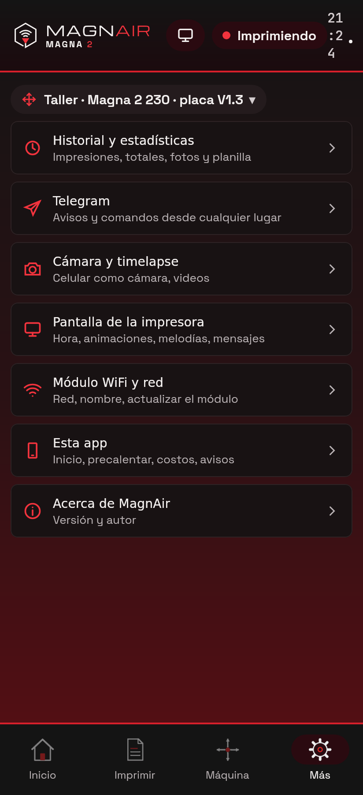 |
| 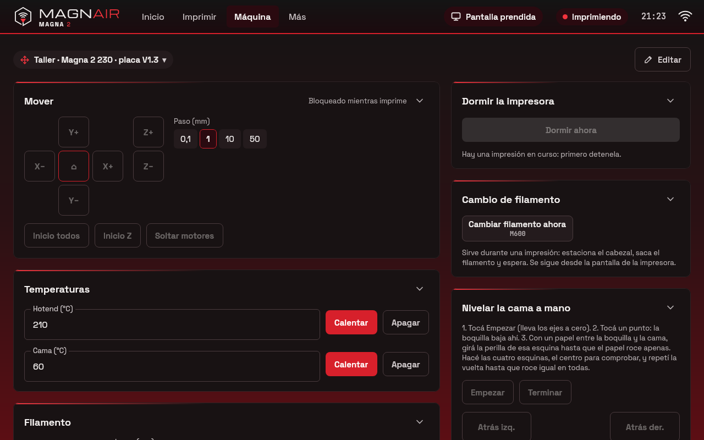 | 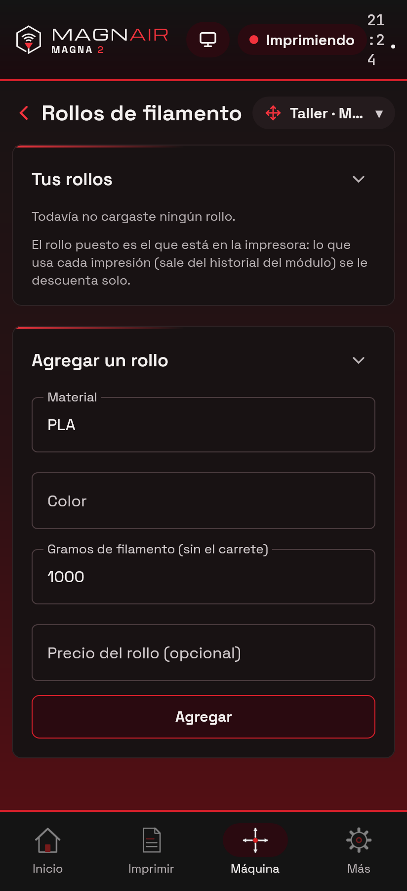 |

Estas capturas las saca GitHub en cada compilación con un módulo simulado, así que siempre muestran la versión actual. Todas las pantallas quedan en [capturas/app](capturas/app).

Detalles de las apps, cómo está organizado el código y la firma del `.apk`: [docs/APPS.md](docs/APPS.md).

## Varias impresoras y modelos

Arriba de cada sección dice qué impresora tenés abierta: el nombre que le pusiste, el modelo y la placa ("Taller · Magna 2 230 · placa V1.3"). El modelo y la placa los manda mi firmware de la impresora, así que la app sabe sola si es una 230, 300, 400, 400D, 500 o 500D y si tiene la placa V1.2 o V1.3. Con eso el visor 3D dibuja la cama del tamaño que corresponde, la nivelación a mano va a las esquinas de esa cama y, con la placa V1.2, el módulo le pregunta menos seguido y la app no muestra lo que esa placa no tiene.

Tocando ese cartel aparece la lista de las impresoras que usaste: elegís otra y la app se pasa a esa, les ponés nombre, las sacás de la lista o agregás una nueva. Se mira una a la vez; cada módulo tiene su propio bot de Telegram.

| Windows | Celular |
|---|---|
| 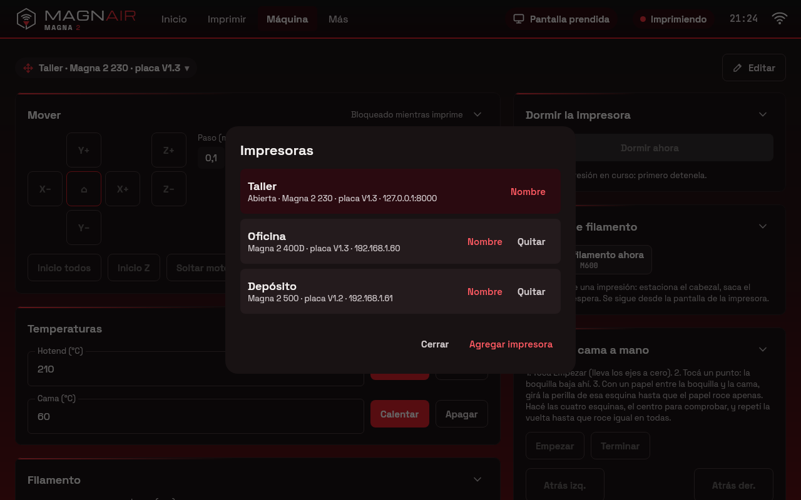 | 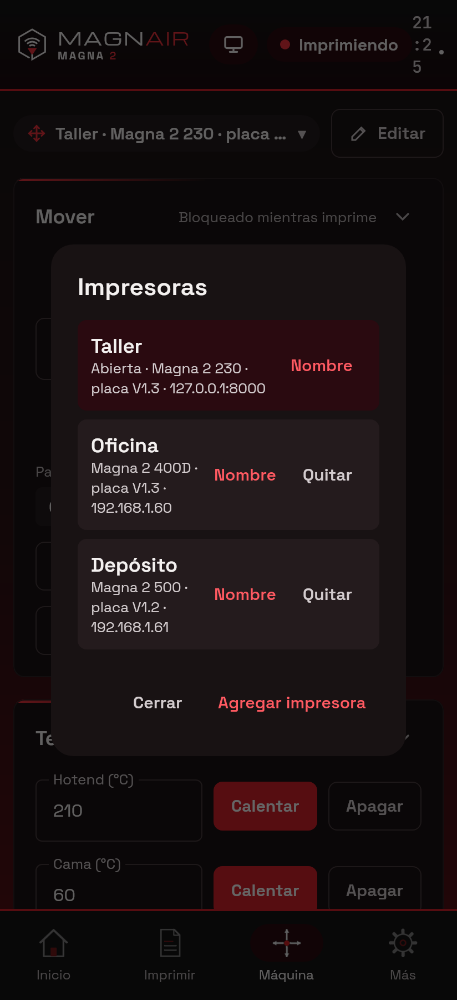 |

## Instalar

Las apps: el `.apk` en el celular, el `.msi` en Windows y en Linux `sudo apt install ./magnair-X.deb` (Linux todavía sin probar en una compu real).

El módulo, lo más fácil es por la SD de la impresora: copiás `MksWifi.bin` a la raíz y la prendés. El paso a paso, y cómo volver al firmware original de Makerbase, está en [docs/INSTALAR.md](docs/INSTALAR.md). Después las actualizaciones se hacen desde Ajustes → Módulo WiFi.

Si el módulo no tiene red configurada arma la suya, **MAGNAIR-XXXX** (clave `magna2230`), y al conectarte el celular abre la página solo. Con la red de tu casa se entra por `http://magnair.local` o por la IP que muestra la pantalla de la impresora.

Lo que ya andaba sigue andando: la pantalla de la impresora muestra la red y la IP, se puede configurar el WiFi desde ahí y el complemento MKS WiFi de Cura sube archivos igual que antes.

## Descargas

Todo está en [Releases](https://github.com/cocolopez/MagnAir-descargas/releases): la app para Android (`.apk`), Windows (`.exe`) y
Linux (`.deb`), y el firmware del módulo WiFi (`MksWifi.bin`, suelto o en un zip con las instrucciones). Las notas
de cada versión dicen qué cambió; la historia completa está en [CAMBIOS.md](CAMBIOS.md).

## Cosas que no se pueden

- La impresora guarda los archivos que llegan por WiFi con nombre corto (las 5 primeras letras + `~1.GCO`). Si dos empiezan igual, el nuevo pisa al viejo; la página avisa antes.
- No se pueden mover, copiar ni renombrar archivos: el firmware de la impresora no tiene cómo. Las subidas van a la raíz.
- Mientras imprime, la impresora no deja leer la SD ni subir archivos. Mientras calibra, calienta esperando, hace home o nivela, no atiende el WiFi; cuando termina se pone al día sola.
- Las respuestas de `M114` (posición de los ejes) no llegan por WiFi.
- Mientras se sube un archivo el módulo no hace otra cosa.
- El timelapse lo graba la app, así que tiene que quedar abierta.
- La página no puede mostrar notificaciones del sistema (el navegador no lo deja en una dirección `http://` local). Para eso están las apps o Telegram.
- La cámara la muestra el navegador directo desde el celular, así que tiene que estar en la misma red que quien mira.

## Autor

Creado por **Andrés Londero** · [andreslondero@gmail.com](mailto:andreslondero@gmail.com)

## Licencia

El código es propio. Las fuentes de `web/fuentes/` (Michroma, Space Grotesk y JetBrains Mono) tienen licencia SIL Open Font License 1.1. El firmware original de Makerbase que está en `wifi-oficial/` es de sus autores y está solo para poder volver atrás.
